# Guía técnica — Dulces Delicias S.A. en Odoo 17

Esta guía explica cómo está configurado Odoo para el caso de estudio y cómo ejecutar (y presentar)
cada numeral, tanto de forma **automática** (simulación) como **manual** desde la interfaz.

---

## Contenido

0. [Arquitectura e instalación](#0-arquitectura-e-instalación)
1. [Configuración de productos y materias primas](#1-configuración-de-productos-y-materias-primas)
2. [Gestión de inventarios](#2-gestión-de-inventarios)
3. [Planificación y ejecución de la producción](#3-planificación-y-ejecución-de-la-producción)
4. [Gestión de clientes (CRM)](#4-gestión-de-clientes-crm)
5. [Gestión de ventas](#5-gestión-de-ventas)
6. [Facturación y pagos](#6-facturación-y-pagos)
7. [Gestión de entregas](#7-gestión-de-entregas)
8. [Atención postventa](#8-atención-postventa)
9. [Reportes](#9-reportes)
10. [Integración entre módulos (flujo contable)](#10-integración-entre-módulos-flujo-contable)
11. [Guion sugerido para la presentación](#11-guion-sugerido-para-la-presentación)
12. [Solución de problemas](#12-solución-de-problemas)

---

## 0. Arquitectura e instalación

### 0.1 Componentes

| Componente | Detalle |
|------------|---------|
| ERP | Odoo 17.0 Community (imagen Docker oficial `odoo:17.0`) |
| Base de datos | PostgreSQL 15 (contenedor `db`) |
| Localización | Guatemala (`l10n_gt`): moneda GTQ, IVA 12 %, plan de cuentas guatemalteco |
| Idioma | Español (Latinoamérica), zona horaria America/Guatemala |
| Módulos estándar | Ventas, CRM, Compras, Inventario, Fabricación, Facturación, Contactos, Métodos de envío |
| Módulo propio | `dulces_delicias` (carpeta `addons/dulces_delicias`) |

**¿Por qué un módulo propio?** Odoo Community no incluye la app *Helpdesk* ni los informes
financieros (*Estado de resultados*), que son exclusivos de Odoo Enterprise. El módulo
`dulces_delicias` agrega:

- La app **Postventa** (casos de atención al cliente) — numeral 8.
- Los **reportes** de inventario, clientes, proveedores y estado de resultados — numeral 9.
- El **perfil de cliente** (tipo de cliente, preferencias, frecuencia de compra, historial) — numeral 4.
- Todos los **datos maestros** del caso y la configuración (almacenes, reglas, diarios, etc.).
- Un **asistente de simulación** que ejecuta todas las transacciones del caso.

### 0.2 Instalación

```bash
./scripts/instalar.sh            # crea la BD "dulces_delicias" e instala el módulo
./scripts/instalar.sh --simular  # además ejecuta todas las transacciones del caso
```

Luego abra <http://localhost:8069> e ingrese con **admin / admin**.

> La primera instalación tarda de 3 a 5 minutos. Para empezar de cero: `./scripts/reiniciar.sh`.

### 0.3 Qué configura el módulo al instalarse

| Área | Configuración |
|------|---------------|
| Empresa | Dulces Delicias S.A., NIT 1234567-8, Calzada Roosevelt zona 11, logo y diseño de documentos |
| Ajustes activados | Unidades de medida, ubicaciones de almacén, rutas multi‑paso, lotes, órdenes de trabajo, direcciones de entrega, descuentos por línea, métodos de envío |
| Contabilidad | Valoración de inventario perpetua (costo promedio) con contabilidad anglosajona; cuentas de inventario de MP, PEP y PT; diarios de pago |
| CRM | Etapas renombradas a **Prospecto → Calificado → Negociación → Cierre (ganado)** |

### 0.4 Línea de tiempo de la simulación

La simulación reparte la operación en las dos semanas anteriores al día en que se ejecuta, como en
una empresa real. Para lograrlo fija el reloj de Odoo en cada paso con la librería `freezegun`, que
viene en la imagen de Odoo. La columna de ejemplo corresponde a una simulación ejecutada el
14/10/2026.

| Días antes | Ejemplo | Evento |
|------------|---------|--------|
| 13 | 01/10 | Inventario inicial; factura y pago del alquiler de la planta |
| 12 | 02/10 | Compra de cacao y leche en polvo por bajo stock |
| 11 | 03/10 | Oportunidad del contrato anual con Supermercado Delicias |
| 10 | 04/10 | Recepción y factura de las compras |
| 9, 8, 7 | 05/10 a 07/10 | Fabricación de caramelos, chocolates y galletas; pago de la planilla de producción |
| 8 | 06/10 | Pago a proveedores; oportunidad de Distribuidora Dulce Sabor |
| 6 | 08/10 | Pedido de Confitería La Dulzura |
| 5 | 09/10 | Pedidos de Supermercado Delicias y Distribuidora Dulce Sabor; factura de energía |
| 4 | 10/10 | Entrega, factura y pago con tarjeta de La Dulzura; pago de energía |
| 3 | 11/10 | Entrega y factura de Supermercado Delicias; oportunidad navideña de La Dulzura |
| 2 | 12/10 | Entrega, factura y pago contra entrega de Dulce Sabor; reclamo del supermercado |
| 1 | 13/10 | Pago parcial del supermercado; devolución, merma y reposición del reclamo |
| 0 | 14/10 | Consulta de La Dulzura, abierta en el tablero |

Las actividades del CRM y la fecha límite de los casos se calculan desde el día de la simulación,
para que estén vigentes durante la demostración.

### 0.5 Dos formas de trabajar

- **Automática:** menú **Dulces Delicias → Configuración → Simular caso de estudio**. Se pueden
  marcar sólo los pasos deseados; cada paso se ejecuta una vez.
  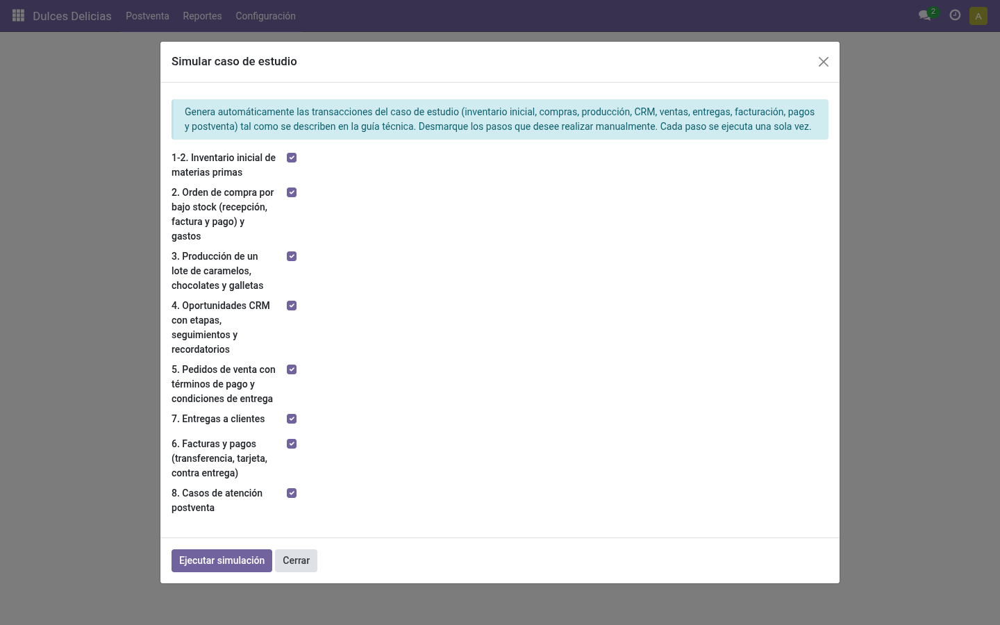
- **Manual:** instale sin `--simular` y siga las secciones "Paso a paso manual" de esta guía.
  Recomendado para que cada integrante del grupo practique su numeral.

---

## 1. Configuración de productos y materias primas

### 1.1 Datos configurados

**Productos terminados** (categoría *Dulces Delicias / Productos Terminados*, rastreados por lote,
ruta *Fabricar*):

| Código | Producto | UdM | Precio venta (IVA incl.) |
|--------|----------|-----|--------------------------|
| PT-CAR | Caramelos surtidos de frutas (bolsa 500 g) | Unidades | Q 25.00 |
| PT-CHO | Chocolates de leche (caja 12 unidades) | Unidades | Q 45.00 |
| PT-GAL | Galletas de mantequilla (paquete 24 unidades) | Unidades | Q 35.00 |

**Materias primas** (categoría *Dulces Delicias / Materias Primas*, ruta *Comprar*):

| Código | Materia prima | UdM | Costo | Stock mín. | Stock máx. | Proveedor |
|--------|---------------|-----|-------|-----------|-----------|-----------|
| MP-AZU | Azúcar refinada | kg | Q 6.00 | 100 | 400 | Azúcares del Sur, S.A. |
| MP-COL | Colorante alimentario | L | Q 120.00 | 1 | 5 | Aromas y Colores, S.A. |
| MP-SAB | Saborizante de frutas | L | Q 150.00 | 2 | 8 | Aromas y Colores, S.A. |
| MP-CAC | Cacao en polvo | kg | Q 45.00 | 10 | 40 | Cacao Maya Verapaz |
| MP-LEC | Leche en polvo entera | kg | Q 40.00 | 8 | 30 | Lácteos San Isidro |
| MP-HAR | Harina de trigo | kg | Q 7.00 | 25 | 100 | Molino Harinero Santa Ana |
| MP-MAN | Mantequilla sin sal | kg | Q 40.00 | 10 | 40 | Lácteos San Isidro |
| MP-HUE | Huevos frescos | Unidades | Q 1.25 | 60 | 360 | Avícola Los Pinos |
| MP-BCA | Bolsa de celofán impresa 500 g | Unidades | Q 0.90 | 100 | 1000 | Empaques y Etiquetas de Centroamérica, S.A. |
| MP-CJB | Caja de cartón para 12 bombones | Unidades | Q 3.50 | 50 | 500 | Empaques y Etiquetas de Centroamérica, S.A. |
| MP-BGA | Bolsa kraft con ventana para 24 galletas | Unidades | Q 1.20 | 100 | 1000 | Empaques y Etiquetas de Centroamérica, S.A. |

Los ingredientes son los que pide el enunciado. Los empaques también son materia prima: sin ellos
no se puede despachar el producto, y su costo entra al costo de cada lote. La leche es en polvo
porque el chocolate no admite agua.

**Listas de materiales** (lote estándar de **100 unidades**):

| Producto | Componentes por lote de 100 | Operaciones (centro de trabajo, minutos por ciclo de 100 u.) |
|----------|-----------------------------|----------------------------------------------------------|
| Caramelos (100 bolsas de 500 g = 50 kg) | Azúcar 50 kg, Colorante 0.25 L, Saborizante 0.5 L, 100 bolsas de celofán | Cocción del jarabe (Cocina, 45) → Moldeado y enfriado (Cocina, 30) → Empaque (Línea de empaque, 20) |
| Chocolates (100 cajas de 12 bombones de 12.5 g = 15 kg) | Cacao 6 kg, Leche en polvo 3.5 kg, Azúcar 5.5 kg, 100 cajas | Mezcla y templado (Línea de chocolate, 40) → Moldeado (Línea de chocolate, 30) → Empaque (20) |
| Galletas (100 paquetes de 24 galletas de 10 g = 24 kg) | Harina 12 kg, Azúcar 5 kg, Mantequilla 7 kg, Huevos 40 u., 100 bolsas kraft | Preparación de masa (Mezcladora, 30) → Horneado (Horno industrial, 35) → Empaque (20) |

Las cantidades cuadran con el peso del producto terminado: los ingredientes de cada lote pesan lo
mismo que el producto, o un poco más en las galletas, que pierden agua al hornearse.

Cada centro de trabajo tiene 10 min de preparación y 10 min de limpieza por orden, y un **costo
por hora** que representa la mano de obra y el uso de la máquina. Con él, el costo de cada lote
incluye la mano de obra y no solo los ingredientes:

| Centro de trabajo | Costo por hora |
|-------------------|----------------|
| Cocina de caramelos | Q 150 |
| Línea de chocolate | Q 180 |
| Mezcladora y amasado | Q 120 |
| Horno industrial | Q 200 |
| Línea de empaque | Q 120 |

### 1.2 Dónde verlo en Odoo

| Qué | Menú |
|-----|------|
| Productos | **Inventario → Productos → Productos** (filtrar por categoría) |
| Unidades de medida | **Inventario → Configuración → Categorías de UdM** |
| Listas de materiales | **Manufactura → Productos → Listas de materiales** |
| Stock mínimo / máximo | **Inventario → Configuración → Reglas de reordenamiento** |
| Proveedores por producto | Ficha del producto → pestaña **Compra** |

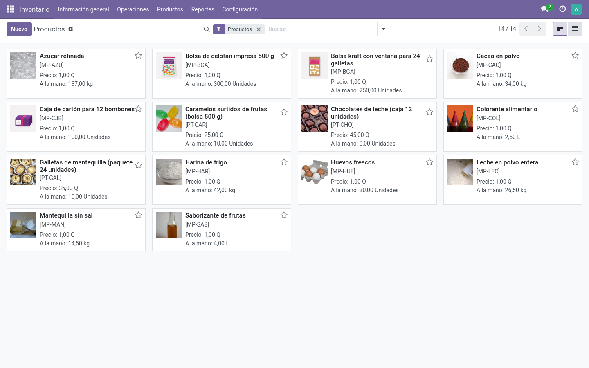
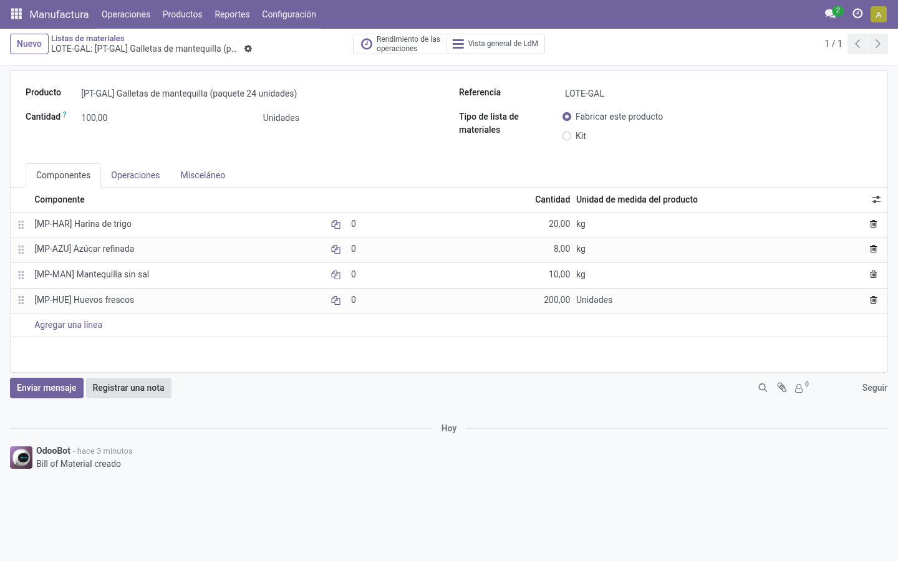

### 1.3 Paso a paso manual (para replicarlo o crear otro producto)

1. **Inventario → Productos → Productos → Nuevo**.
2. Nombre, *Tipo de producto*: **Almacenable**, *Categoría*, *Unidad de medida* (kg, L, Unidades).
3. Pestaña **Inventario** → *Rutas*: **Comprar** (materia prima) o **Fabricar** (producto
   terminado); para productos terminados marque *Rastreo*: **Por lotes**.
4. Pestaña **Compra** → agregue el proveedor, precio y plazo de entrega.
5. Para el stock mínimo/máximo: botón **Mín/Máx** en la ficha del producto (o *Reglas de
   reordenamiento*) → ubicación **DD/Existencias/Materias Primas**, cantidad mínima y máxima,
   *Activador*: **Automático**.
6. Para la receta: **Manufactura → Productos → Listas de materiales → Nuevo**, cantidad 100,
   pestaña *Componentes* y pestaña *Operaciones* (centro de trabajo y duración).

---

## 2. Gestión de inventarios

### 2.1 Almacenes configurados

El almacén **Planta Dulces Delicias** (código `DD`) tiene tres almacenes internos, uno por etapa:

| Almacén / ubicación | Uso |
|---------------------|-----|
| `DD/Existencias/Materias Primas` | Destino de las compras; origen de los insumos para producción |
| `DD/Productos en Proceso` | Insumos trasladados a la planta, consumidos por las órdenes de fabricación |
| `DD/Existencias/Productos Terminados` | Destino de la producción; origen de las entregas a clientes |
| `DD/Existencias/Producto No Conforme (devoluciones)` | Devoluciones de clientes (postventa) |

La fabricación está configurada en **2 pasos**: *Materias Primas → (traslado) → Productos en
Proceso → (orden de fabricación) → Productos Terminados*.

Menú: **Inventario → Configuración → Almacenes** y **→ Ubicaciones**.

### 2.2 Inventario inicial

| Materia prima | Inventario inicial | ¿Bajo el mínimo? |
|---------------|-------------------|------------------|
| Azúcar | 250 kg | No |
| Colorante | 3 L | No |
| Saborizante | 5 L | No |
| **Cacao** | **6 kg** | **Sí (mín. 10)** |
| **Leche en polvo** | **5 kg** | **Sí (mín. 8)** |
| Harina | 60 kg | No |
| Mantequilla | 25 kg | No |
| Huevos | 90 u. | No |
| Bolsas de celofán | 500 u. | No |
| Cajas para bombones | 200 u. | No |
| Bolsas kraft | 400 u. | No |

**Paso a paso manual:** **Inventario → Operaciones → Inventario físico** → *Nuevo* (o *Aplicar*
sobre las líneas) → producto, ubicación *Materias Primas*, *Cantidad contada* → **Aplicar** →
referencia "Inventario inicial".

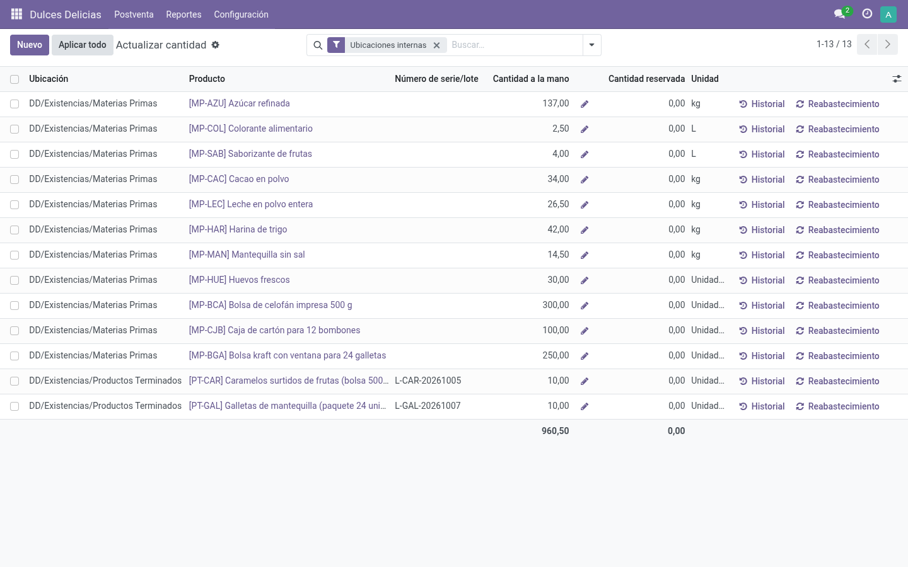

### 2.3 Orden de compra por bajo stock

El cacao y la leche quedan por debajo del mínimo. Las reglas de reordenamiento calculan cuánto
pedir para llegar al máximo:

| Proveedor | Producto | Cantidad pedida | Total (IVA incl.) |
|-----------|----------|-----------------|-------------------|
| Cacao Maya Verapaz | Cacao en polvo | 34 kg (40 − 6) | Q 1,530.00 |
| Lácteos San Isidro | Leche en polvo entera | 25 kg (30 − 5) | Q 1,000.00 |

**Paso a paso manual:**

1. **Inventario → Operaciones → Reabastecimiento**: aparecen los productos bajo mínimo con la
   cantidad sugerida → botón **Ordenar una vez** (o espere al planificador automático).
2. **Compras → Pedidos → Solicitudes de presupuesto**: abra la solicitud generada → **Confirmar
   pedido**.
3. Botón **Recepción** → **Validar** (las cantidades ingresan a *Materias Primas*).
4. Botón **Crear factura** → fecha de factura → **Confirmar** → **Registrar pago** (diario
   *Banco - Transferencia bancaria*).

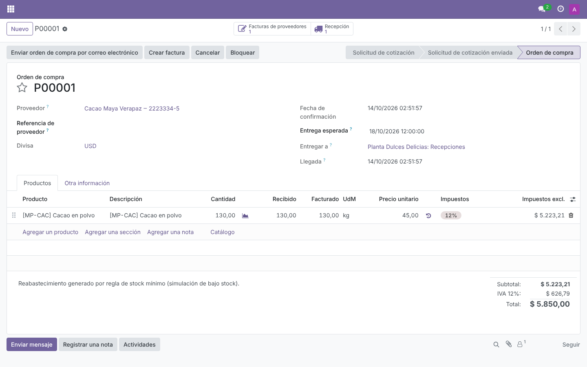

> Al confirmar la orden de galletas, los **huevos** previstos bajan a 30 u. (mínimo 60). Como la regla
> es automática, Odoo genera por sí solo una **solicitud de presupuesto** a Avícola Los Pinos por
> 330 huevos (Q 412.50) para volver al máximo de 360:
> 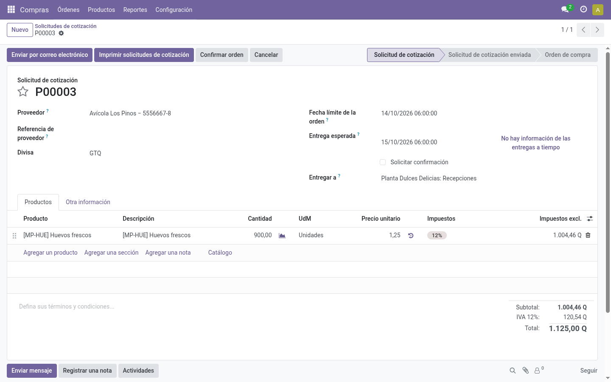

---

## 3. Planificación y ejecución de la producción

### 3.1 Lotes planificados

| Orden | Producto | Cantidad | Lote | Consumo de materias primas |
|-------|----------|----------|------|----------------------------|
| DD/MO/00001 | Caramelos | 200 bolsas | L-CAR-AAAAMMDD | 100 kg azúcar, 0.5 L colorante, 1 L saborizante, 200 bolsas |
| DD/MO/00002 | Chocolates | 100 cajas | L-CHO-AAAAMMDD | 6 kg cacao, 3.5 kg leche en polvo, 5.5 kg azúcar, 100 cajas |
| DD/MO/00003 | Galletas | 150 paquetes | L-GAL-AAAAMMDD | 18 kg harina, 7.5 kg azúcar, 10.5 kg mantequilla, 60 huevos, 150 bolsas |

Cada lote se fabrica en un turno distinto, de 7:00 hasta que termina la última operación:
caramelos 250 min, chocolates 150 min y galletas 230 min.

| Lote | Ingredientes y empaque | Mano de obra (centros de trabajo) | Costo unitario |
|------|------------------------|-----------------------------------|----------------|
| Caramelos (200) | Q 990.00 | Q 595.00 | Q 7.93 |
| Chocolates (100) | Q 755.92 | Q 410.00 | Q 11.66 |
| Galletas (150) | Q 846.00 | Q 580.00 | Q 9.51 |

La mano de obra se carga a la cuenta de **productos en proceso** al terminar cada lote. El asiento
"Planilla de operarios de producción" (Q 1,585.00) registra el pago de esa planilla y deja la cuenta
en cero.

### 3.2 Paso a paso manual

1. **Manufactura → Operaciones → Órdenes de fabricación → Nuevo**: producto, cantidad → la lista
   de materiales y las operaciones se cargan solas → **Confirmar**.
2. Botón **Traslados** (DD/PC/…): traslado de materias primas a *Productos en Proceso* →
   **Validar**.
3. En la orden: **Comprobar disponibilidad** → asigne el **Número de lote** (o use el botón de
   generar lote).
4. Pestaña **Órdenes de trabajo**: para cada operación pulse **Iniciar** y luego **Hecho**
   (también desde **Manufactura → Operaciones → Órdenes de trabajo**). Odoo registra la duración
   real y la compara con la esperada.
5. **Producir todo** / **Marcar como hecho**: consume los insumos y registra el lote terminado en
   *Productos Terminados*.
6. Verifique el impacto: **Inventario → Reportes → Existencias**, la regla de reordenamiento de los
   huevos y el reporte *Estado del inventario* (numeral 9).

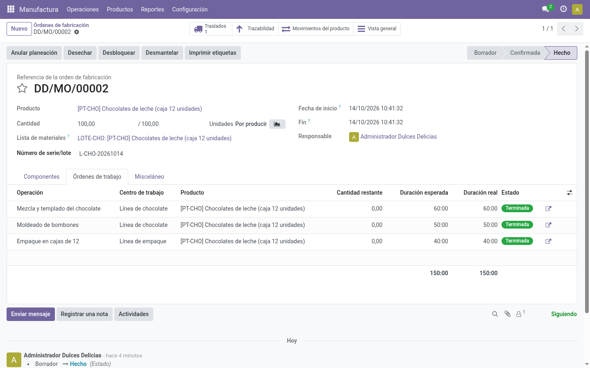
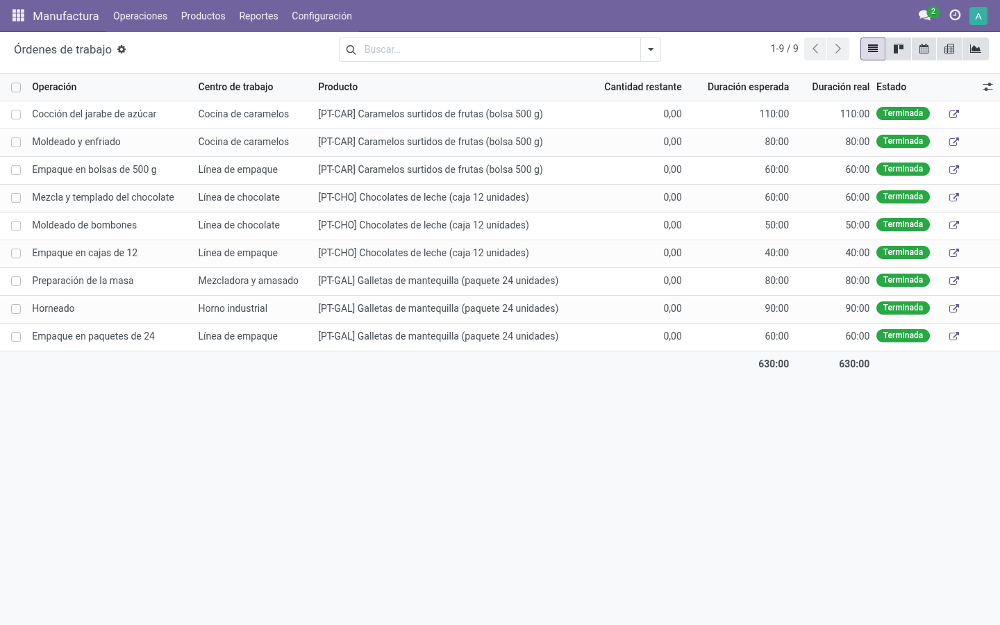

---

## 4. Gestión de clientes (CRM)

### 4.1 Perfiles de clientes

| Cliente | Tipo | Contacto | Ubicación | Plazo de pago | Preferencias |
|---------|------|----------|-----------|---------------|--------------|
| Confitería La Dulzura | Confitería / Minorista | María Fernanda López (Propietaria) | Antigua Guatemala | Pago inmediato | Caramelos y galletas; recibe lunes 8–11 h; paga con tarjeta |
| Supermercado Delicias | Supermercado / Cadena | Jorge Alberto Méndez (Jefe de compras) | Ciudad de Guatemala (entrega en CD Villa Nueva) | 30 días | Chocolates y galletas; vida útil mínima 60 días; cita previa |
| Distribuidora Dulce Sabor | Distribuidor / Mayorista | Ana Lucía Pérez (Gerente comercial) | Quetzaltenango | 15 días | Los tres productos por volumen; descuento 5 %; paga en efectivo |

En la ficha del cliente (**CRM → Ventas → Clientes** o **Contactos**) están las pestañas:

- **Perfil Dulces Delicias**: tipo de cliente, frecuencia de compra, total comprado, productos
  preferidos y preferencias.
- **Historial de compras**: todos los pedidos del cliente con su estado de facturación y entrega.
- Botones inteligentes: Oportunidades, Ventas, Facturado, Casos postventa.

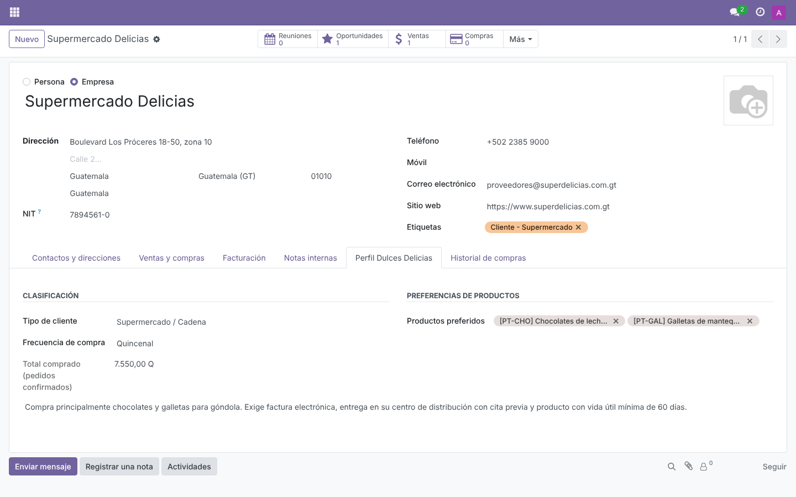

### 4.2 Oportunidades y ciclo de ventas

| Oportunidad | Cliente | Etapa | Ingreso esperado | Seguimientos / recordatorios |
|-------------|---------|-------|------------------|------------------------------|
| Surtido navideño para 2 tiendas | Confitería La Dulzura | **Prospecto** (20 %) | Q 8,000 | Llamada para presentar catálogo (+2 días); correo con lista de precios (+3 días) |
| Contrato anual de suministro – góndola de chocolates | Supermercado Delicias | **Negociación** (60 %) | Q 120,000 | Preparar propuesta con 5 % de descuento (+1 día); reunión de negociación (+5 días) |
| Pedido mayorista región occidente | Distribuidora Dulce Sabor | **Cierre (ganado)** | Q 3,166 | Llamada de seguimiento post‑entrega (+7 días); vinculada al pedido S00003 |

**Paso a paso manual:**

1. **CRM → Ventas → Mi flujo → Nuevo**: nombre, cliente, ingreso esperado → *Agregar*.
2. Arrastre la tarjeta entre columnas para cambiar de etapa (Prospecto → Negociación → Cierre).
3. En la oportunidad: **Actividades** (ícono de reloj) → tipo *Llamada / Reunión / Correo*,
   fecha límite y resumen → **Programar**. Las actividades vencidas se ven en rojo y aparecen en
   el reloj de la barra superior (recordatorios).
4. Para cerrar: botón **Ganado** (o **Perdido** con motivo). Desde la oportunidad, el botón
   **Nueva cotización** crea el pedido de venta vinculado.

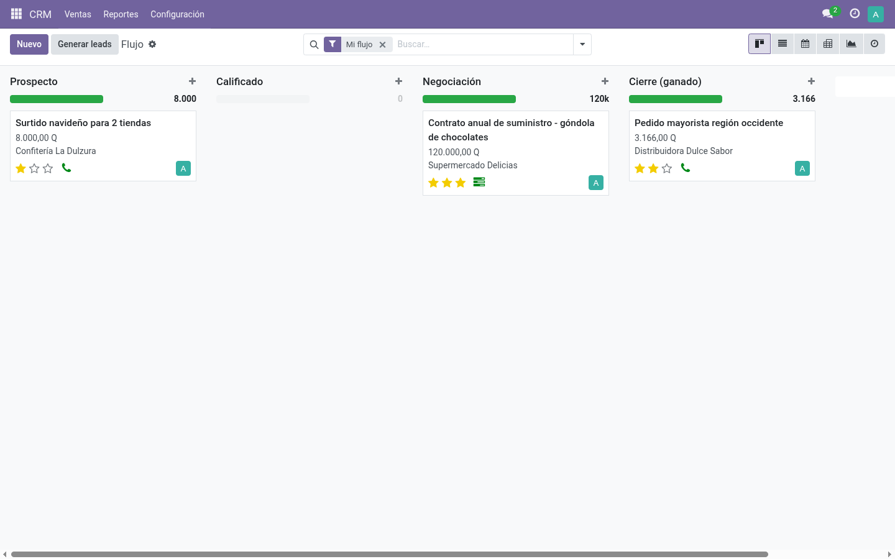

---

## 5. Gestión de ventas

### 5.1 Pedidos configurados

| Pedido | Cliente | Caramelos | Chocolates | Galletas | Plazo de pago | Condiciones de entrega | Total |
|--------|---------|-----------|------------|----------|---------------|------------------------|-------|
| S00001 | Confitería La Dulzura | 50 | 20 | 30 | Pago inmediato | Reparto propio (gratis > Q1,500), incoterm DAP, entrega parcial permitida | Q 3,200.00 |
| S00002 | Supermercado Delicias | 100 | 50 | 80 | 30 días | Reparto propio a su centro de distribución, DAP, **entregar todo junto** | Q 7,550.00 |
| S00003 | Distribuidora Dulce Sabor | 40 | 25 | 30 | 15 días | Transporte a departamentos (Q150), incoterm CPT, descuento 5 % | Q 3,166.25 |

Las notas del pedido (*Términos y condiciones*) detallan horario, cita previa y forma de pago, y
cada pedido tiene **fecha de entrega comprometida** y la **orden de compra del cliente**
(*Referencia del cliente*).

**Paso a paso manual:**

1. **Ventas → Órdenes → Cotizaciones → Nuevo**: cliente (el plazo de pago se toma de su ficha),
   *Dirección de entrega*, líneas de producto y cantidades.
2. Pestaña **Otra información**: *Política de envío* (lo antes posible / cuando todos estén
   listos), *Fecha de entrega*, *Incoterm*, *Referencia del cliente*.
3. Botón **Agregar envío** → elija el método de envío (reparto propio, transporte a
   departamentos, recoger en planta).
4. **Enviar por correo electrónico** (cotización) → **Confirmar**.
5. Seguimiento: **Ventas → Órdenes → Órdenes** (columnas *Estado de factura* y *Estado de
   entrega*), vistas de calendario, pivote y gráfico, y **Ventas → Reportes → Ventas**.

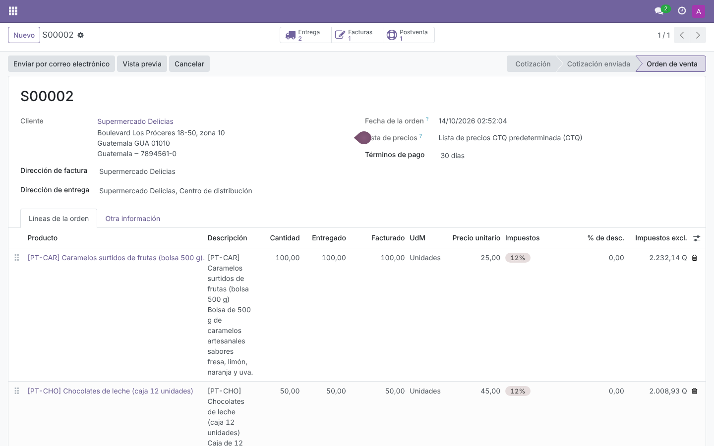

---

## 6. Facturación y pagos

### 6.1 Métodos de pago configurados (diarios)

| Método de pago | Diario | Tipo |
|----------------|--------|------|
| Transferencia bancaria | Banco - Transferencia bancaria (BNK1) | Banco |
| Tarjeta de crédito | Tarjeta de crédito (TARJ) | Banco |
| Pago contra entrega | Pago contra entrega (PCE) | Efectivo |

Menú: **Facturación → Configuración → Diarios**.

### 6.2 Facturas y pagos

| Factura | Cliente | Total | Pago registrado | Estado |
|---------|---------|-------|-----------------|--------|
| INV/2026/00001 | Confitería La Dulzura | Q 3,200.00 | Tarjeta de crédito, Q 3,200.00 | Pagado |
| INV/2026/00002 | Supermercado Delicias | Q 7,550.00 | Transferencia, Q 3,775.00 (50 %) | Pago parcial (saldo a 30 días) |
| INV/2026/00003 | Distribuidora Dulce Sabor | Q 3,166.25 | Contra entrega (efectivo), Q 3,166.25 | Pagado |

**Paso a paso manual:**

1. En el pedido de venta: **Crear factura** → *Factura regular* → **Crear y ver factura**.
2. **Confirmar** → **Enviar e imprimir** (envía el PDF al cliente por correo).
3. **Registrar pago** → elija el *Diario* (transferencia, tarjeta o contra entrega), monto y fecha
   → **Crear pago**. Si el monto es menor, la factura queda *Pago parcial*.
4. Consultas: **Facturación → Clientes → Facturas** y **Facturación → Clientes → Pagos**.

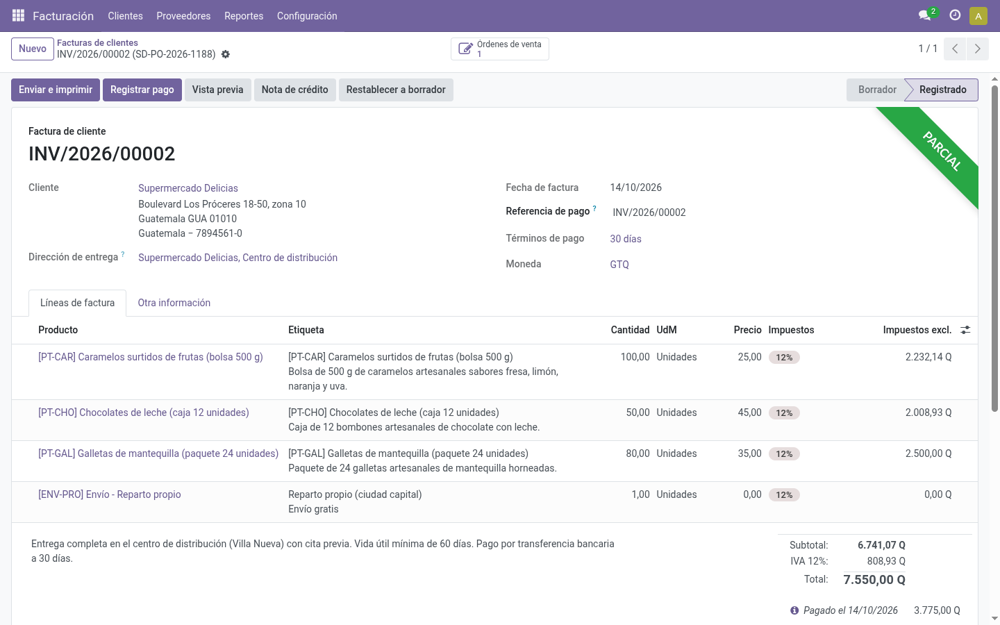

---

## 7. Gestión de entregas

Cada pedido confirmado genera una entrega (`DD/OUT/…`) desde *Productos Terminados*, que reserva
automáticamente el **lote** fabricado.

**Paso a paso manual:**

1. **Inventario → Información general** (tablero) → tarjeta **Órdenes de entrega**, o el botón
   **Entrega** del pedido de venta.
2. Planificación: revise la *Fecha programada*, la *Dirección de entrega*, el *Método de envío* y
   registre la *Referencia de seguimiento* (número de guía). Vista calendario para planificar.
3. **Comprobar disponibilidad** (reserva el lote) → **Imprimir → Albarán/Guía de entrega**.
4. Cuando el cliente recibe el producto: **Validar**. La entrega pasa a **Hecho** y el pedido a
   *Entregado completamente*.

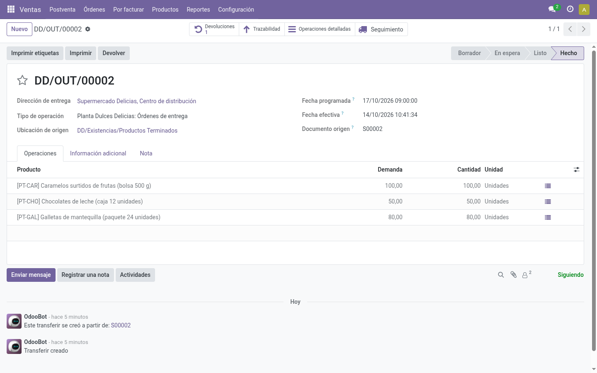

---

## 8. Atención postventa

### 8.1 App Postventa

Menú **Dulces Delicias → Postventa → Casos postventa** (también en **Ventas → Postventa**).

- Etapas: **Nuevo → En análisis → En resolución → Resuelto → Cerrado**
  (configurables en *Dulces Delicias → Configuración → Etapas postventa*).
- Cada caso se vincula a **cliente, pedido, entrega, factura, producto y lote**.
- Tipos: producto dañado, producto incorrecto, faltante, retraso, error de facturación, consulta.
- Seguimiento con chatter, actividades y fecha límite de respuesta.
- Botones de resolución:
  - **Registrar devolución** → crea la devolución hacia *Producto No Conforme*.
  - **Desechar producto dañado** → registra la merma (va a la cuenta *Mermas y producto dañado*).
  - **Enviar reposición** → crea una entrega sin costo del producto.
  - **Crear nota de crédito** → cuando la solución es nota de crédito o reembolso.
  - **Marcar como resuelto** / **Cerrar caso**, con encuesta de satisfacción.

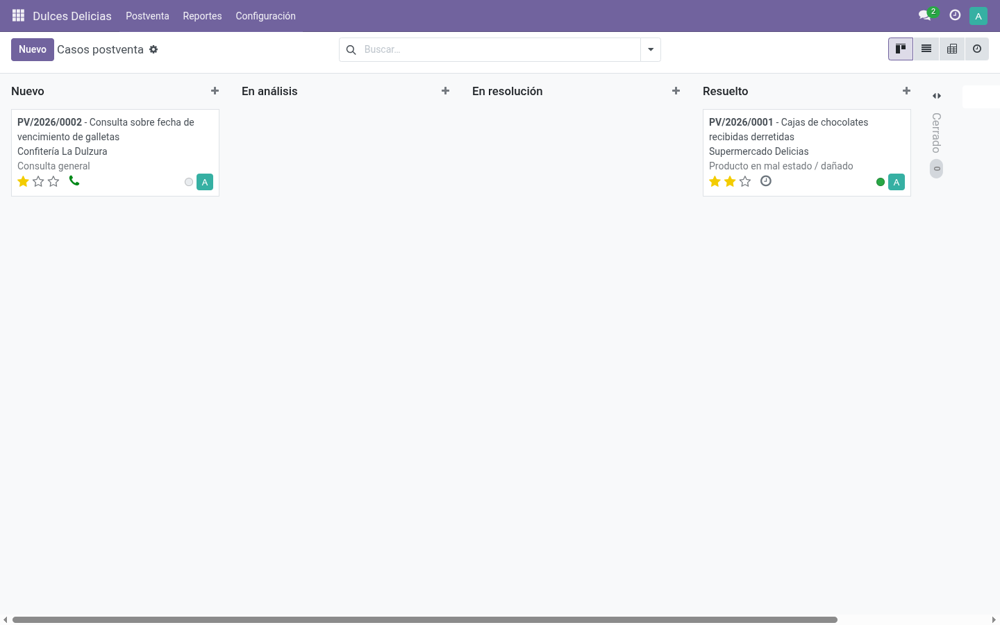

### 8.2 Caso registrado

**PV/2026/0001 — "Cajas de chocolates recibidas derretidas"** (Supermercado Delicias, pedido
S00002, lote L-CHO-…):

1. *Nuevo*: el jefe de compras reporta por correo 5 cajas derretidas; se programa la actividad
   "Confirmar recepción de la reposición" con fecha límite.
2. *En análisis*: se revisan las fotos — el empaque no tenía protección térmica.
3. *En resolución*: solución **Reposición** → devolución de 5 cajas (DD/IN/…) a *Producto No
   Conforme* → merma del producto dañado → entrega de reposición de 5 cajas (DD/OUT/…).
4. *Resuelto*: causa raíz "transporte sin empaque térmico", acción correctiva (hieleras
   térmicas), satisfacción del cliente **Muy satisfecho**.

Un segundo caso (**PV/2026/0002**, consulta de La Dulzura sobre fecha de vencimiento) queda en
*Nuevo* con una llamada programada, para mostrar un caso abierto en el tablero.

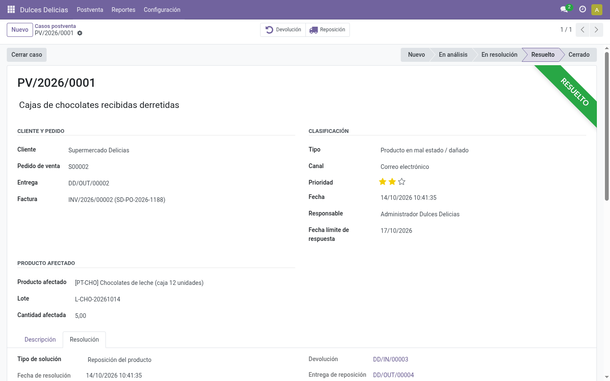

**Paso a paso manual:** *Casos postventa → Nuevo* → asunto, cliente, **pedido** (completa entrega
y factura), producto, cantidad → guarde → avance las etapas → pestaña *Resolución* → elija el tipo
de solución y use los botones del encabezado → **Marcar como resuelto**.

---

## 9. Reportes

Menú **Dulces Delicias → Reportes**:

| Reporte | Menú | Contenido |
|---------|------|-----------|
| **Estado de resultados** | Reportes → Estado de resultados | Para un período *Desde/Hasta*: ingresos, costo de ventas, utilidad bruta, gastos de operación, utilidad de operación, otros ingresos/gastos, utilidad neta, márgenes y detalle por cuenta. En pantalla o PDF |
| **Estado del inventario** | Reportes → Estado del inventario (PDF) | Por ubicación/categoría: disponible, por recibir, por entregar, mínimo, máximo, estado (Normal / Bajo mínimo / Sobre máximo), costo y valor; existencias por ubicación y lote |
| Existencias por ubicación | Reportes → Existencias por ubicación | Vista dinámica de Odoo (agrupar por ubicación, producto, lote) |
| Reabastecimiento | Reportes → Reabastecimiento (mín./máx.) | Reglas de stock con cantidades a pedir |
| **Listado de clientes** | Reportes → Listado de clientes / Imprimir reportes | Tipo, NIT, contacto, teléfono, correo, ciudad, plazo, productos preferidos, pedidos y monto facturado |
| **Listado de proveedores** | Reportes → Listado de proveedores / Imprimir reportes | NIT, contacto, plazo, productos que suministra, órdenes y monto comprado |

El menú **Imprimir reportes (PDF)** reúne los cuatro reportes con los botones **Ver en pantalla**
y **Descargar PDF**.

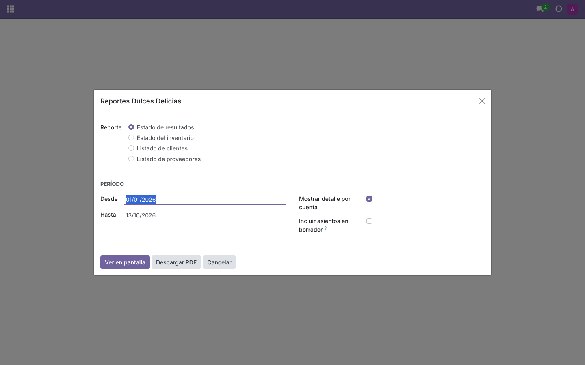

### 9.1 Estado de resultados del caso (año en curso)

| Concepto | Importe | % |
|----------|---------|---|
| Ingresos por ventas (sin IVA) | Q 12,425.22 | 100.0 % |
| Costo de ventas (ingredientes, empaque y mano de obra de lo vendido, más la merma) | Q 4,002.60 | 32.2 % |
| **Utilidad bruta** | **Q 8,422.62** | **67.8 %** |
| Gastos de operación (alquiler de planta y energía eléctrica, sin IVA) | Q 6,500.00 | 52.3 % |
| **Utilidad neta del período (antes de ISR)** | **Q 1,922.62** | **15.5 %** |

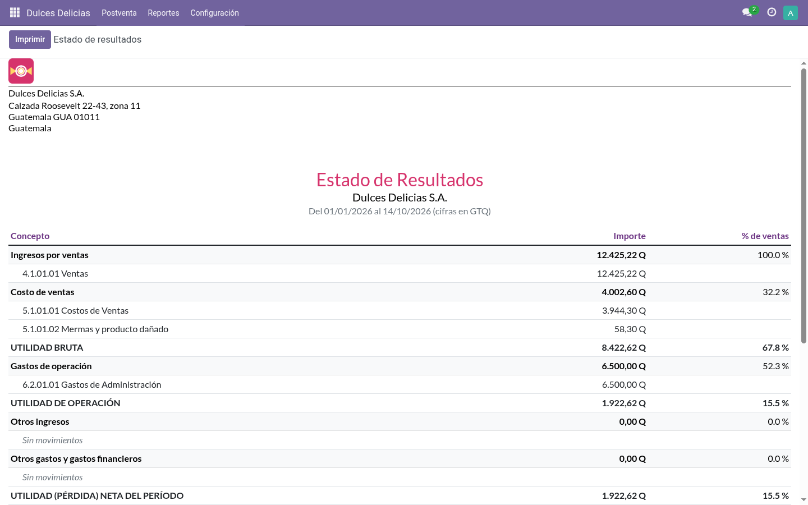

En `docs/ejemplos/` hay PDF de ejemplo de cada reporte.

**Cómo se calcula:** se suman los apuntes contables *publicados* del período agrupados por cuenta y
clasificados por tipo de cuenta del plan contable (ingresos, costo directo, gastos; las cuentas 7.x
se presentan como gastos financieros). Al ser contabilidad perpetua anglosajona, el costo de ventas
corresponde exactamente al costo de los productos facturados.

---

## 10. Integración entre módulos (flujo contable)

```
Compras ──► Recepción ──► Materias Primas ──► Productos en Proceso ──► Fabricación ──► Productos Terminados ──► Entrega ──► Factura ──► Pago
   │            │                                                         │                                     │            │          │
 Factura    Inventario MP                                           Inventario PT                          Costo de    Ingreso    Banco /
 proveedor  (1.1.04.01)                                              (1.1.04.03)                            ventas      por venta  Tarjeta /
 (CxP)                                                                                                      (5.1.01.01) (4.1.01.01) Caja
                                  CRM (oportunidad) ──► Cotización ──► Pedido ──┘                Postventa ──► Devolución / Merma / Reposición / Nota de crédito
```

| Evento | Asiento automático |
|--------|--------------------|
| Inventario inicial | Inventario MP / Saldo inicial de inventarios (patrimonio) |
| Recepción de compra | Inventario MP / Mercadería recibida pendiente de facturar |
| Factura de proveedor | Mercadería recibida + IVA por cobrar / Proveedores |
| Consumo y producción | Inventario PEP / Inventario MP (ingredientes y empaque); Inventario PT / Inventario PEP (incluye la mano de obra) |
| Planilla de producción | Inventario PEP / Banco (paga la mano de obra aplicada a los lotes) |
| Entrega al cliente | Mercadería entregada pendiente de facturar / Inventario PT |
| Factura de cliente | Clientes / Ventas + IVA por pagar; Costo de ventas / Mercadería entregada |
| Pago | Banco, Tarjeta o Caja / Clientes |
| Merma postventa | Mermas y producto dañado / Inventario PT |

---

## 11. Guion sugerido para la presentación

| Diapositiva | Numeral | Qué mostrar en vivo | Captura |
|-------------|---------|---------------------|---------|
| 1 | Introducción | Empresa, objetivos, módulos instalados | `01_inicio.png` |
| 2–3 | 1 | Productos, materias primas, UdM, listas de materiales | `02`, `03`, `04` |
| 4–5 | 2 | Almacenes, inventario inicial, reglas mín./máx., compra por bajo stock | `05`, `06`, `07`, `08` |
| 6–7 | 3 | Orden de fabricación, traslado a PEP, órdenes de trabajo, lote, impacto en inventario | `09`, `10` |
| 8–9 | 4 | Perfil de clientes, flujo CRM por etapas, actividades | `11`, `12` |
| 10 | 5 | Pedidos con plazo de pago e incoterm, seguimiento | `13` |
| 11 | 6 | Facturas, tres métodos de pago, pago parcial | `15` |
| 12 | 7 | Entregas, guía, validación | `14` |
| 13 | 8 | Caso postventa de punta a punta | `16`, `17` |
| 14–15 | 9 | Estado de resultados, inventario, clientes, proveedores | `18`, `19`, `20`, `21` |
| 16 | Conclusiones | Integración entre módulos (sección 10) | — |

---

## 12. Solución de problemas

| Problema | Solución |
|----------|----------|
| `localhost:8069` no carga | `docker compose ps`; ver registros con `docker compose logs -f odoo` |
| El puerto 8069 está ocupado | Cambie `"8069:8069"` por `"8070:8069"` en `docker-compose.yml` |
| Olvidé la contraseña | `docker compose run --rm odoo odoo shell -d dulces_delicias` y luego `env.ref('base.user_admin').password='admin'; env.cr.commit()` |
| Quiero repetir la simulación | `./scripts/reiniciar.sh` y luego `./scripts/instalar.sh --simular` |
| Actualicé el módulo | `docker compose run --rm odoo odoo -d dulces_delicias -u dulces_delicias --stop-after-init` y `docker compose restart odoo` |
| Las fechas aparecen un día antes | Las fechas se registran en hora de Guatemala (UTC‑6); es el comportamiento esperado |
| El PDF sale sin formato | Genere los PDF con el servidor en marcha (`docker compose up -d odoo`) |
